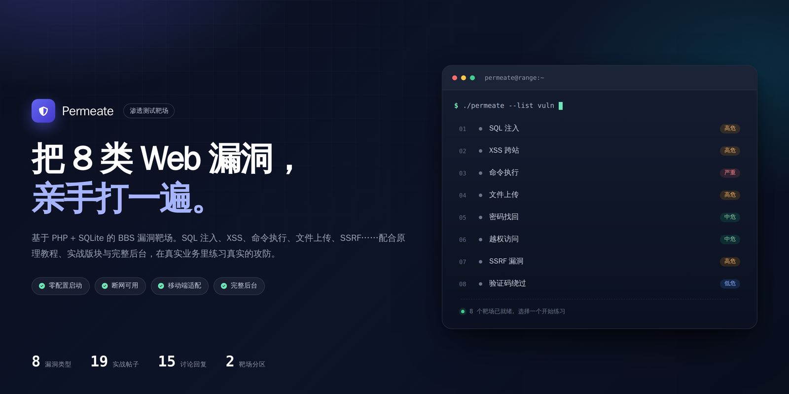
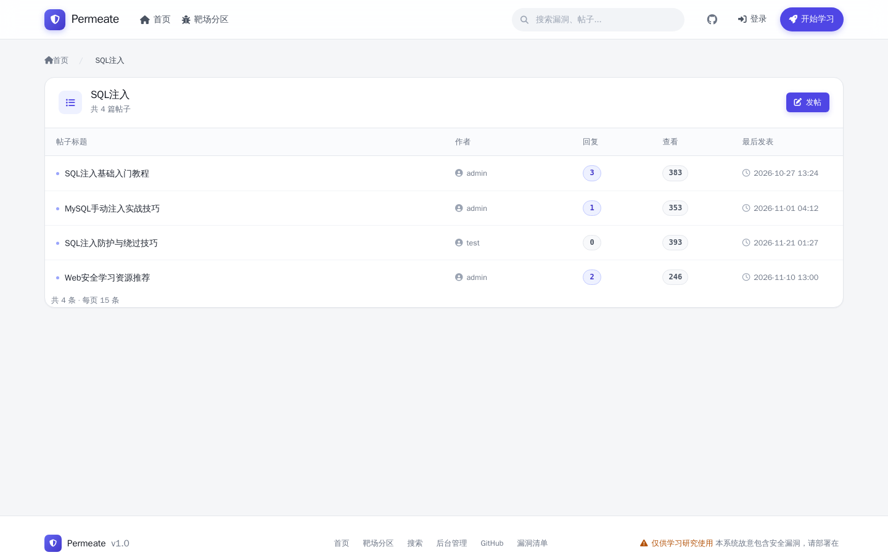
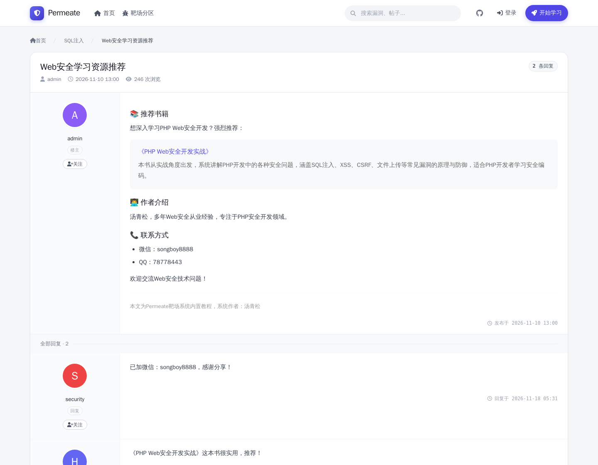
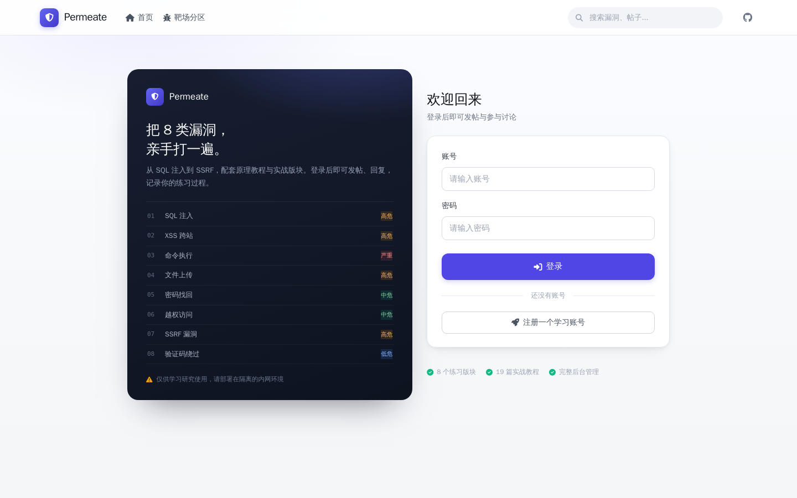
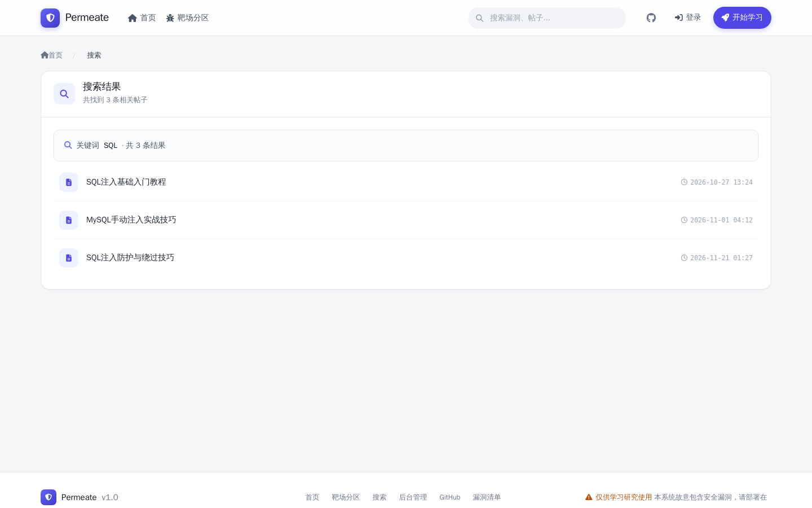
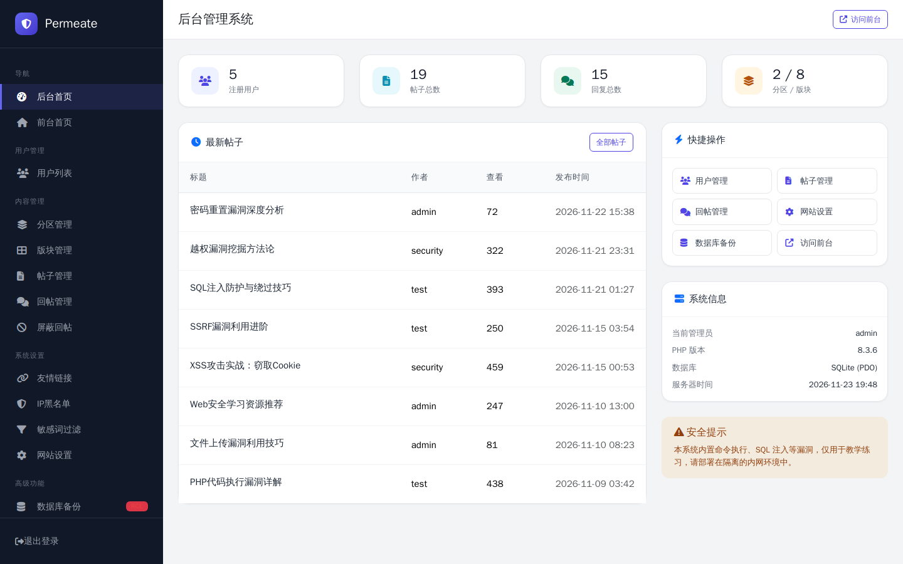

<div align="center">
  
</div>

<p align="center">
  <strong>把 8 类 Web 漏洞，亲手打一遍。</strong><br>
  <span>PHP + SQLite · 零配置启动 · 前端依赖全部内置 · 断网可用</span>
</p>

<p align="center">
  <a href="LICENSE"></a>
  
  
  
  
</p>

<p align="center">
  一条命令启动：<code>php install/init_sqlite.php && php -S localhost:8080</code>
</p>

---

## 项目简介

Permeate（渗透）是一款基于 PHP 开发的 BBS 论坛靶场，把 **SQL 注入、XSS、命令执行、文件上传、SSRF、越权、密码重置、验证码绕过** 8 类漏洞藏进真实的论坛业务里，适合：

- WEB安全教学演示
- 渗透测试技能练习
- 漏洞挖掘能力训练
- 安全意识培训

## 为什么是 Permeate

| 亮点 | 说明 |
| --- | --- |
| **真实业务场景** | 注册登录、发帖回复、搜索、个人中心、关注，漏洞分布在真实功能里，而不是孤立的小 demo |
| **8 类漏洞 + 配套教程** | 每个版块都配有原理讲解与实战帖子，从理解原理到动手利用一步到位 |
| **完整后台管理** | 用户、分区、版块、帖子、回复、敏感词、IP 黑名单、数据库备份，后台首页自带数据仪表盘 |
| **零配置 / 离线可用** | 一条命令初始化 SQLite，无需 MySQL；Bootstrap、Font Awesome、UEditor 全部内置，断网也能跑 |
| **移动端适配** | 前台与后台均做了响应式处理，手机、平板都能正常浏览与练习 |

## 界面预览


|  |  |
| --- | --- |
|  |  |
| **帖子列表** | **帖子详情** |
|  |  |
| **登录页** | **搜索练习** |

后台管理：



## 漏洞清单

| 漏洞类型 | 漏洞位置 | 难度 |
|---------|---------|------|
| **SQL注入** | 搜索功能、帖子列表、用户信息 | ⭐⭐ |
| **XSS跨站** | 帖子回复、帖子内容 | ⭐⭐ |
| **命令执行** | 后台备份、Ping工具 | ⭐⭐⭐ |
| **SSRF** | 远程头像获取 | ⭐⭐⭐ |
| **文件上传** | 附件上传功能 | ⭐⭐ |
| **水平越权** | 用户资料修改 | ⭐⭐ |
| **密码重置** | 找回密码功能 | ⭐⭐⭐ |
| **验证码绕过** | 登录验证码 | ⭐ |

> 详细的漏洞利用方式请参考 [doc/VULNERABILITIES.md](doc/VULNERABILITIES.md)

## 技术栈

- **后端**: PHP 7.0+
- **数据库**: SQLite (PDO)
- **前端**: Bootstrap 5 + 响应式设计（依赖已内置在 `public/vendor/`，无需外网 CDN）
- **编辑器**: UEditor（本地内置）

## 快速安装

### 环境要求

- PHP >= 7.0
- PDO SQLite 扩展
- GD 扩展（后台登录验证码）
- 无需 MySQL 数据库

### 方式一：一键安装（推荐）

```bash
# 1. 克隆项目
git clone https://github.com/78778443/permeate.git

# 2. 进入项目目录
cd permeate

# 3. 初始化数据库
php install/init_sqlite.php

# 4. 启动PHP内置服务器
php -S localhost:8080
```

访问 http://localhost:8080 即可使用。

### 方式二：Web安装

1. 将项目部署到Web服务器目录
2. 浏览器访问 `/install/index.php`
3. 填写管理员账号密码，点击安装

### 方式三：Docker安装

```bash
# 构建镜像
docker build -t permeate .

# 运行容器
docker run -d -p 8080:80 permeate
```

## 默认账号

| 用户名 | 密码 | 权限 |
|--------|------|------|
| admin | 123456 | 管理员 |
| test | 123456 | 普通用户 |

## 功能模块

### 前台功能
- 用户注册/登录
- 帖子发布/回复
- 搜索功能
- 个人中心（头像、资料、密码）
- 用户关注

### 后台功能
- 用户管理
- 版块管理
- 帖子管理
- 数据备份

## 目录结构

```
permeate/
├── admin/              # 后台模块
│   ├── action/         # 控制器
│   ├── public/         # 公共文件
│   └── tpl/            # 模板文件
├── home/               # 前台模块
│   ├── action/         # 控制器
│   ├── public/         # 公共文件
│   └── tpl/            # 模板文件
├── core/               # 核心函数
├── conf/               # 配置文件
├── data/               # SQLite数据库
├── doc/                # 文档
├── install/            # 安装程序
├── test/               # 测试脚本
└── uploads/            # 上传目录
```

## 运行测试

```bash
# 功能测试
php test/test_all.php

# 页面测试
php test/test_pages.php
```

## 安全警告

⚠️ **本系统包含安全漏洞，仅供学习使用！**

- 请勿部署到公网环境
- 请勿用于非法用途
- 建议在隔离环境中运行

## 常见问题

**Q: 数据库文件在哪里？**
A: SQLite数据库文件位于 `data/permeate.db`

**Q: 如何重置数据库？**
A: 删除 `data/permeate.db` 和 `install/install.lock`，重新运行安装

**Q: 忘记密码怎么办？**
A: 删除数据库重新安装，或使用SQLite工具直接修改密码字段

## 参与贡献

欢迎提交 Issue 和 Pull Request

## 联系方式

- **作者**：汤青松
- **微信**：songboy8888
- **QQ**：78778443
- **QQ交流群**：832677177
- **推荐书籍**：《PHP Web安全开发实战》

## License

[MIT License](LICENSE)

Copyright (c) 2017-2024 汤青松
